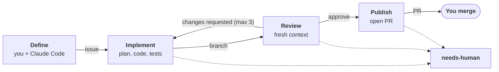

# agent-runner

**Turn an idea into a merge-ready pull request, with AI agents doing the work and a human making the decisions.**

You describe what you want in a conversation. agent-runner turns that conversation into a well-defined GitHub issue, then a set of agents plans the change, writes the code and tests, reviews it with fresh eyes, and opens a pull request. You review and merge it. Agents never merge.

> **Status:** early. Only the first stage, **Define**, is built and usable today. The rest of the pipeline is fully specified in [docs/ai-workflow.md](docs/ai-workflow.md) but not built yet.

## Why

Handing a vague task to a coding agent usually goes one of two ways: it guesses at what you meant, or it stops to ask questions nobody is around to answer. agent-runner fixes that by moving every decision to the start, while you're still in the conversation:

- **Decide first, then automate.** An interview pins down the problem, the design, the rejected alternatives and what "done" means *before* any code is written. After that, the pipeline runs unattended.
- **A human at both ends.** You confirm the issue before anything runs, and you merge the PR at the end. Everything in between is automated, and anything that goes wrong is handed back to you.
- **Everything lives in GitHub.** Decisions, plans, reviews and cost records are stored as issues, comments and PRs in your repo. Any PR can be traced back to the conversation that shaped it, years later, without any extra tooling.
- **Costs are capped by code, not by hope.** Every agent runs under a hard token budget, so no single run can spiral.

## How it works

The pipeline has four stages. Each one reads its input from GitHub and writes its output back, so any stage can be re-run on its own.



| Stage | Where it runs | What happens |
| --- | --- | --- |
| **Define** | Claude Code, on your machine | An AI interviews you about the idea, checks nothing required is missing, shows you the full issue, and creates it once you say "yes". |
| **Implement** | GitHub Actions | Checks the issue is complete, writes a plan, makes the change on a branch, and gets tests and lint passing. |
| **Review** | GitHub Actions | A separate reviewer sees only the issue and the diff (not the implementer's reasoning) and approves or requests changes. |
| **Publish** | GitHub Actions (plain script, no AI) | Rebases onto `main`, re-runs tests, and opens a PR linked to the issue. |

If a run gets stuck (the review loop hits 3 rounds, a budget runs out, or the rebase conflicts), it stops, pushes its work in progress, and labels the issue `needs-human`. Nothing is ever force-resolved.

### What a good issue looks like

Every issue that Define creates follows the same template ([template/issue.yml](template/issue.yml)), and Implement refuses issues that don't:

- **Problem / motivation**: why this matters
- **Proposed solution**: the agreed design
- **Decision summary**: each decision, with the options rejected and why
- **Acceptance criteria**: concrete conditions for done, each checkable by a test or command
- **Out of scope**: what was explicitly left out
- **Links**: a trace ID, the Define session ID, and any prototype branches

Plus one label: `feature`, `bug` or `refactor`. The label changes how the work is done; for example, a `bug` must first get a failing test that reproduces it.

## Using Define today

### Requirements

- [Claude Code](https://claude.com/claude-code)
- The [GitHub CLI](https://cli.github.com/) (`gh`), logged in
- A **private** target repository. Anyone who can open a labelled issue there can start a paid run, so Define refuses to work in public repos.
- The `grilling` skill installed at `~/.claude/skills/grilling`. Define uses it to run the interview.

### Install

Open Claude Code inside the repo you want to work on, then run:

```
/plugin marketplace add ajorquera/agent-runner
/plugin install agent-runner
```

### Define a new piece of work

```
/agent-runner:define add CSV export to the reports page
```

Claude will:

1. **Interview you** about the idea until you both agree on the design. Along the way it can search your codebase, or build a quick throwaway prototype (pushed as a `proto/<slug>-<n>` branch) when it's easier to decide by seeing something work.
2. **Check for gaps** against the template, such as a decision with no alternatives considered, and ask only about those.
3. **Show you the complete issue.** Reply `yes` to create it; anything else is treated as an edit.
4. **Create the issue** under your own GitHub account, with a type label, a trace ID and a comment recording how many tokens the conversation used.

### Fix an issue that was sent back

If the completeness check marks an issue `needs-definition`, rework it in place:

```
/agent-runner:define 42
```

Claude reads what was missing, asks only about that, updates the issue and queues it for another run.

## Repository layout

| Path | What's there |
| --- | --- |
| `skills/define/` | The Define skill. `SKILL.md` is the entry point; `DEFINER.md` has the full instructions. |
| `agents/` | Helper agents used during Define: the **explorer** (read-only code search) and the **prototyper** (throwaway prototypes). |
| `template/issue.yml` | The issue template. Define and the completeness check both read it, so they can't drift apart. |
| `src/` | TypeScript for the issue structure check and the trace comment. |
| `scripts/` | Bundled builds of `src/`. They're committed because installing a plugin never runs `npm install`. |
| `docs/ai-workflow.md` | The full design: budgets, tracing, security, evaluation, and the reasoning behind each decision. |

## Development

Requires Node 22.18 or later.

```sh
npm install
npm test            # run the tests
npm run typecheck
npm run build       # rebuild scripts/*.mjs; do this after any change under src/ and commit the result
```

## Learn more

[docs/ai-workflow.md](docs/ai-workflow.md) is the source of truth for how the whole pipeline is meant to work, including the parts not built yet: the per-agent budgets, how runs are traced, the security model, and how results are evaluated over time.
