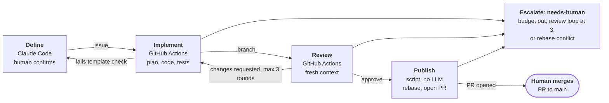

# AI Workflow

## Overview

This is a spec for a system that takes an idea from a first conversation to a merge-ready pull request. Every requirement here (budgets, traces, retention) is enforced by code, not by prompts.

- **Runtime:** a hybrid. The Define stage runs interactively in Claude Code, because it needs a human in the conversation. Implement, Review and Publish run headless in GitHub Actions on an orchestrator built with the Claude Agent SDK.
- **Source of truth:** GitHub (private repo). Every stage reads its input from GitHub and writes its output back, so any stage can be re-run without repeating the whole pipeline.
- **Output:** a pull request to `main`, linked to its issue and trace ID. Agents never merge; a human always does.

## Pipeline

The pipeline has four stages: Define, Implement, Review and Publish. Each one has a single input and a single output, both stored in GitHub.

**Every run ends at a human: a merge or an escalation.**



*Pipeline flow · 4 stages, 2 loops, 2 human endpoints*

Review can send work back to Implement up to 3 times, and a failed template check sends the issue back to Define. Every other path ends with a human merging the PR or picking up an escalation.

| Stage | Runs in | Input | Output |
| --- | --- | --- | --- |
| Define | Claude Code (interactive) | A short prompt | An issue that follows the template, with a type label, trace ID, decision summary and session ID |
| Implement | GitHub Actions | The issue (plus the existing branch on rework) | Branch `<issue#>-<slug>`, the plan as an issue comment, local tests and lint passing, a trace comment |
| Review | GitHub Actions | The issue and the branch diff | A verdict (`approve` / `changes_requested`), findings as structured comments, a trace comment |
| Publish | GitHub Actions (script, no LLM) | An approved branch | A PR to `main` with a summary, `Closes #<issue>`, the trace ID and the plan |

### Trigger

The pipeline starts when the definer agent creates the issue. The workflow runs on `issues.opened` only if all of these are true:

- the author is the pipeline's bot or GitHub App identity,
- the issue has a type label (`feature`, `bug` or `refactor`),
- the body contains a trace ID.

Issues opened by hand never start a run. To have one processed, take it through Define.

### Template check

Implement starts with a single cheap call that checks the issue against the template. If the issue fails, the check comments on what is missing, adds `needs-definition` and stops. Re-running Define on that issue updates it instead of creating a new one.

### Review loop

A `changes_requested` verdict sends the work back to Implement, with the findings as extra input. After 3 rounds the run escalates to a human.

### Re-running a stage

Adding a `rerun:<stage>` label (or a workflow dispatch) re-runs that stage from its stored input. Each re-run gets a new trace ID, linked to the old one through `previous_trace_id`.

### Concurrency and a moving `main`

- Runs on the same issue are serialised with an Actions `concurrency` group per issue (`cancel-in-progress: false`). Runs on different issues go in parallel.
- Implement branches from the latest `main`. Before Publish, the orchestrator rebases onto `main`. A clean rebase re-runs tests and opens the PR; a conflict escalates and is never auto-resolved.
- The pipeline's job ends when the PR is open. The PR's normal CI is the final check, and keeping the PR up to date is the human's job from there.

## Human touchpoints

There are two required human actions and one forced escalation. Nothing else in the pipeline waits for a person.

1. **Confirm in Define (start gate).** The definer creates the issue only after the human explicitly confirms the final draft in the conversation. That confirmation replaces the vague exit criterion "no remaining doubt".
2. **Merge (end gate).** A human reviews and merges every PR. Branch protection on `main` requires human approval, so agents can't merge.
3. **Escalation.** The run stops when any of these happens: the review loop reaches 3 rounds, a budget runs out at the root, or the rebase before Publish conflicts. When it stops, the orchestrator pushes the branch as WIP, posts a trace comment with the trace ID, and adds the `needs-human` label.

There is no gate for approving the plan. The plan is posted on the issue and included in the PR, so the human sees it at merge. Add a plan gate only if evaluation shows wrong plans are a frequent cause of failure.

## Issue template

Every issue from Define must have these sections. The template check at the start of Implement checks them.

| Section | Contents |
| --- | --- |
| Problem / motivation | Why this matters |
| Proposed solution | The agreed design |
| Decision summary | Decisions made in Define, including options that were rejected and why. This is the permanent record of the conversation. |
| Acceptance criteria | Concrete, testable conditions for done |
| Out of scope | What we explicitly decided not to do |
| Links | Trace ID, Claude Code session ID of the Define conversation, prototype branches |
| Type label | `feature`, `bug` or `refactor`. It decides which extra instructions Implement and Review get (see Agents). |

## Agents

There are six agents, and each is defined in its own `<AGENT>.md`. The orchestrator enforces an allow-list of which agent may call which. An agent can't spawn anything outside its row, so an implementer can't spawn another implementer.

| Agent | Stage | Role | May call |
| --- | --- | --- | --- |
| definer (`DEFINER.md`) | Define | Runs `/grill-me`, explores the codebase, prototypes, writes the issue | explorer, prototyper |
| explorer (`EXPLORER.md`) | Any | Read-only codebase search that returns a summary | Nothing (leaf) |
| prototyper (`PROTOTYPER.md`) | Define | Builds a throwaway prototype on a scratch branch | Nothing (leaf) |
| implementer (`IMPLEMENT.md`) | Implement | Plans, edits code, runs tests and lint | explorer, test-writer |
| test-writer (`TEST-WRITER.md`) | Implement | Writes tests for the acceptance criteria | explorer |
| reviewer (`REVIEWER.md`) | Review | Checks the change against acceptance criteria, conventions and coverage | explorer |

- **Depth:** in practice the deepest chain is 2 (stage agent → helper → explorer). The depth limit is a backstop.
- **Reviewer independence:** the reviewer starts with a fresh context and sees only the issue and the diff, never the implementer's transcript. That stops it from simply agreeing with the implementer's reasoning.
- **Template check:** this is a single call inside Implement, not an agent.

### Instructions by type label

Every label uses the same agents and budgets. The label only adds a section to the implementer's and reviewer's instructions.

| Label | Implementer must | Reviewer checks |
| --- | --- | --- |
| `bug` | First write a failing test that reproduces the bug, then fix it | The reproduction test exists and fails without the fix |
| `refactor` | Keep behaviour the same; existing tests pass without being edited | Rejects test-file changes unless they're justified |
| `feature` | Write tests for every acceptance criterion | Every criterion has a test |

The config allows separate budgets, models or agents per label. Use them only when evaluation data shows a difference.

## Budgets

Budgets are hierarchical, so each run has a hard upper bound on cost: no run can use more than 10M tokens.

### How budgets work

- **Carved out:** when a parent spawns a child, the child's tokens and calls come out of the parent's remaining budget. If the parent doesn't set an amount, the child gets 50% of what the parent has left.
- **Max calls** counts every call in the subtree, not just direct children.
- **Max depth** is measured from the root of the run (the stage agent is depth 0).
- **Token counting:** all input, including cache reads, plus output. This is conservative and simple to explain. The cost of a run is its root's usage.

### Starting values

| Agent | Tokens (subtree) | Max calls (subtree) | Max depth |
| --- | --- | --- | --- |
| implementer | 3M | 10 | 2 |
| test-writer | 50% of what the parent has left (default) | 3 | — |
| reviewer | 1M | 4 | 2 |
| explorer | 300k | 0 | Leaf |
| template check | Single call, about 30k | 0 | — |
| definer | Recorded only, not enforced (interactive) | — | — |

- **Rework rounds:** each Implement round after a review gets 50% of the first round's budget.
- **Per-run cap:** the whole run stops at 10M tokens, regardless of what is left at stage level.
- **Recalibration:** after about 20 runs, set each cap to roughly the 90th percentile of what successful runs used, times 1.5.

### When a budget runs out

1. **Hard stop.** The orchestrator, not the model, cuts the agent off at its cap. The agent gets one final turn from a small reserved budget to return `{status: "budget_exhausted", done: [...], remaining: [...], state: "..."}`.
2. **The parent decides.** That report comes back to the parent as a normal tool result. The parent can continue with the partial work or pass the failure up.
3. **At the root:** the orchestrator pushes the branch as WIP, posts a trace comment with `status: budget_exhausted`, adds `needs-human` and stops.
4. **No automatic top-up.** Re-running with a larger budget is a human decision, made with `rerun:<stage>`. The re-run resumes from the pushed branch.
5. **Depth limit:** a spawn past the limit is refused immediately with an error. The agent continues without that sub-agent, and nothing else stops.

## Traceability and storage

Any PR can be traced back to its decisions permanently, using GitHub alone. Raw transcripts are kept for 30 days for debugging.

### Trace model

Each pipeline run gets a unique `trace_id`. Every agent call is a span with `span_id` and `parent_span_id`, so the run can be rebuilt as a tree. The fields follow OpenTelemetry naming, so a tracing backend can be added later without changing the data.

### Two retention tiers

| Data | Where | Retention |
| --- | --- | --- |
| Decision summary | Issue body | Permanent |
| Implementation plan | Issue comment | Permanent |
| Review verdicts and findings | PR review comments | Permanent |
| Trace metadata (one JSON comment per stage) | Issue (Define, Implement) or PR (Review, Publish) | Permanent |
| Implement, Review and Publish transcripts | GitHub Actions artifacts (`retention-days: 30`), linked from the trace comment | 30 days |
| Define transcript | Local Claude Code session (`cleanupPeriodDays`); session ID recorded in the issue | About 30 days |

The path PR → review → plan → issue → decisions works forever without opening a transcript. After 30 days the transcript links stop working, which is expected.

### Trace comment format

Each stage posts one bot comment with a collapsible, machine-readable block:

```
<details><summary>Trace: implement · 412k tokens · 7 calls · ok</summary>

{"trace_id":"…","span_id":"…","parent_span_id":"…","previous_trace_id":null,
 "stage":"implement","agent":"implementer","tokens":412000,"calls":7,"max_depth":2,
 "status":"ok","transcript":"<artifact-url>","children":[…]}
</details>
```

Repo collaborators can edit these comments, so treat them as records, not tamper-proof evidence. Move the metadata to a database only if querying it through the GitHub API becomes painful.

### Constraints

- The repo must stay private. Anyone with read access can download the artifacts.
- The repo or org artifact retention limit must not be set below 30 days.

## Security

Even a confused or compromised agent can change only its own branch, and a human still has to merge.

- **The orchestrator owns git.** Agents edit files in the workspace. The orchestrator commits and pushes, only to the run's branch `<issue#>-<slug>`. Agents never hold a token that can push.
- **Minimal token permissions:** `contents: write` (for the orchestrator's push), `issues: write` and `pull-requests: write`. Nothing else.
- **Branch protection on `main`** requires human approval.
- **Agent environment:** only the Anthropic API key is passed in. There are no deploy or cloud secrets. Test credentials are limited to dedicated test accounts.
- **Network:** package registries and the Anthropic API are allowed; everything else is blocked where the runner setup allows it.
- **The reviewer is read-only.** It has no write tools and can't run arbitrary commands; at most it can run the test suite.

## Evaluation

A scheduled GitHub Action collects the trace comments and GitHub outcomes into a weekly report. Once there are about 20 merged runs, a replay benchmark is added to test prompt changes.

| Metric group | Metrics | Source |
| --- | --- | --- |
| Process | Tokens per stage; review loops per run; escalation rate and cause (review loop, budget, rebase); budget exhaustion by level; time from issue to PR; template-check rejections | Trace comments |
| Outcome | PR merged as-is; size of human edits before merge (commits, lines); closed without merge; CI failures on the PR; reverted or linked to a bug within 30 days | GitHub |
| Regression benchmark (later) | Replay a fixed set of 10–20 past issues after any change to a prompt, model or budget, and compare process and outcome metrics with the baseline | Replay runs |

Until the benchmark exists, treat changes to `IMPLEMENT.md`, `REVIEWER.md` or the budgets as experiments, and judge them by the weekly report.

## Resolved questions

All four open questions from the first draft are now answered.

| Question | Answer | Section |
| --- | --- | --- |
| Where are agent transcripts stored, and for how long? | Actions artifacts for 30 days (headless stages); local Claude Code session for Define. Decisions and trace metadata are kept in GitHub permanently. | Traceability and storage |
| What are the concrete budget values per stage? | Implementer 3M tokens / 10 calls, reviewer 1M / 4, explorer 300k, a 10M cap per run; recalibrated after about 20 runs | Budgets |
| Where must a human approve before the pipeline continues? | Confirming the issue in Define, and merging the PR. Escalation on an exhausted review loop, an exhausted budget or a rebase conflict. | Human touchpoints |
| Does each issue label map to a different setup? | Only the instructions change; budgets can be set per label but start the same | Agents |
